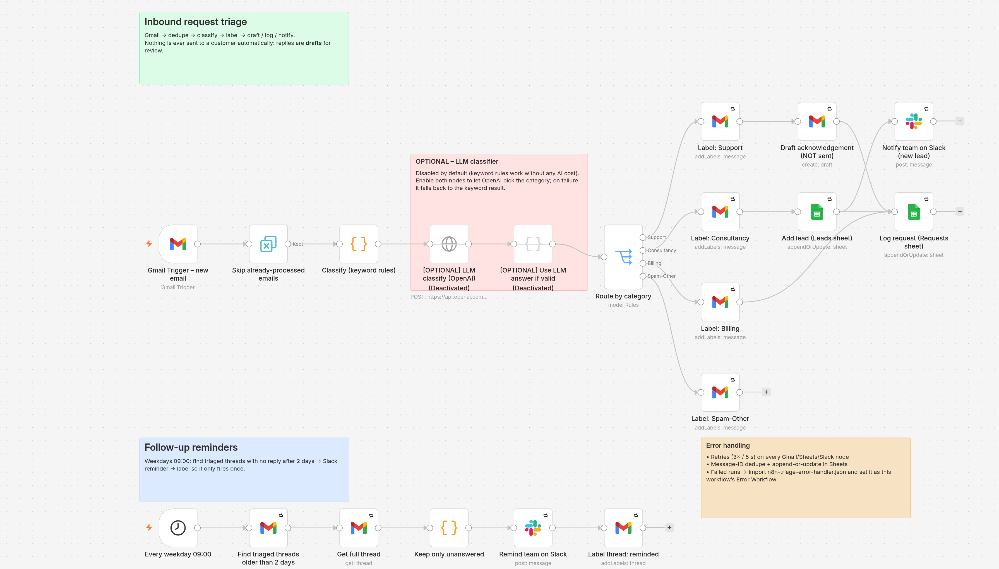
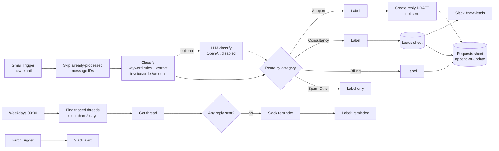

# n8n Gmail inbound request triage (demo)

A working demo of an n8n workflow for an IT support & consultancy inbox. It watches Gmail, sorts each new email by type, pulls out invoice and order details, logs it to Google Sheets, drafts replies for a person to review, alerts the team about new leads, and sends reminders when a request has gone unanswered.

Built by Jimmy Sullivan as a portfolio demo. It uses placeholder credentials and made-up sample emails.

## What it does

| Step | Node(s) | Detail |
|---|---|---|
| 1. Watch the inbox | Gmail Trigger | Polls every minute. Set Label IDs to watch only a shared inbox or a specific label. The `-from:me -label:triage-done` query stops it from re-processing its own mail. |
| 2. Skip duplicates | Remove Duplicates | Remembers Gmail message IDs across executions, so retries or re-polls never handle the same email twice. |
| 3. Classify and extract | Code: "Classify (keyword rules)" | Weighted keyword rules (English and German) sort mail into **Support / Consultancy / Billing / Spam-Other**. The same step extracts the **invoice number, order number and amount**. Mail with no keyword match goes to Support, marked `needsHumanReview`, so nothing gets hidden as spam. |
| 3b. *(optional)* LLM | HTTP Request to OpenAI, then a Code merge step | **Disabled by default.** When enabled, the LLM picks the category. If the API fails or returns an unexpected category, the keyword result is kept. |
| 4. Route | Switch | One output per category. |
| 5. Label | Gmail "Add labels" | `triage-<category>` plus `triage-done`. |
| 6a. Support | Gmail "Create draft" | Writes an acknowledgement **draft** in the same thread. **Nothing is sent automatically.** |
| 6b. Consultancy | Google Sheets, then Slack | Adds the lead (name, email, subject, date) to the **Leads** sheet and posts it to `#new-leads`. |
| 6c. Billing | Google Sheets | Logs the request with its invoice number, order number and amount. |
| 6d. Spam-Other | – | Labels it only. No reply and no log entry. |
| 7. Log | Google Sheets append-or-update | Writes every non-spam request to the **Requests** sheet, keyed on `messageId` (a second guard against duplicates). |
| 8. Follow-ups | Schedule, Gmail threads, Code, Slack, Gmail label | At 09:00 every weekday, finds triaged threads older than 2 days with **no message from us (no SENT label)**. It sends a Slack reminder, then labels the thread `triage-reminded` so each reminder fires only once. |
| Errors | Retry settings plus `n8n-triage-error-handler.json` | Every Gmail, Sheets and Slack node retries 3 times, 5 s apart. Failed runs go to the error-handler workflow (Error Trigger, then a Slack alert with the node, the error and an execution link). |

## Files

| File | What it is |
|---|---|
| `n8n-triage-workflow.json` | The main workflow (24 nodes). Import this. |
| `n8n-triage-error-handler.json` | The error workflow (Error Trigger, then a Slack alert). |
| `src/classify.js` | The classification rules. Edit keywords here. |
| `src/build-workflow.js` | Regenerates the workflow JSON so the Code node always uses the tested `classify.js`. |
| `tests/` | Sample emails, test scripts and saved results. |
| `diagram.png`, `error-handler.png` | Screenshots of both workflows in the n8n editor. |
| `flow-mermaid.png` | The flow diagram above, rendered as an image. |
| `proposal.md` | Cover letter for the Upwork job. |

## How to import

1. In n8n (Cloud or self-hosted), go to **Workflows**, choose **Import from File**, and import `n8n-triage-error-handler.json`, then `n8n-triage-workflow.json`.
   Self-hosted CLI: `n8n import:workflow --input=n8n-triage-error-handler.json` and then `n8n import:workflow --input=n8n-triage-workflow.json`.
2. Open the main workflow's **Settings** and set **Error Workflow** to "Triage – error handler". The ID is already prefilled if you imported through the CLI.

## Setup

1. **Credentials.** Create Gmail OAuth2, Google Sheets OAuth2 and Slack credentials, plus OpenAI if you want the optional LLM step. Select them on each node; they are placeholders in the JSON.
2. **Gmail labels.** Create `triage-support`, `triage-consultancy`, `triage-billing`, `triage-spam-other`, `triage-done` and `triage-reminded`. In each "Label:" node, choose the label from the dropdown (this replaces the `REPLACE_WITH_LABEL_ID_*` placeholders).
3. **Google Sheet.** Create one spreadsheet with two tabs:
   - **Requests** with columns `messageId, receivedAt, fromName, fromEmail, subject, category, confidence, invoiceNumber, orderNumber, amount, needsHumanReview, status`
   - **Leads** with columns `messageId, name, email, subject, date`

   Then paste the spreadsheet ID into both Sheets nodes.
4. **Slack.** Set the channels (`#new-leads`, `#support`, `#automation-alerts`). Or swap these nodes for Gmail "Send" nodes if you prefer email alerts.
5. **Tune it.** Edit the keyword lists in the Classify node (or `src/classify.js`, then run `npm run build`). Edit the draft text, and change `older_than:2d` to set the reminder delay.
6. Test with **Execute workflow** on a few real emails, then turn the workflow on.

## Test results

**Keyword classifier (`npm test`), 9 sample emails:**

| # | Subject | Expected | Got | Confidence | Extracted | Pass |
|---|---|---|---|---|---|---|
| 1 | Outlook stopped receiving emails | Support | Support | high | – | ✅ |
| 2 | Quote for Microsoft 365 migration | Consultancy | Consultancy | high | – | ✅ |
| 3 | Invoice INV-2026-0142 overdue | Billing | Billing | high | invoiceNumber: INV-2026-0142, amount: €249,00 | ✅ |
| 4 | Rank #1 on Google in 30 days!!! | Spam-Other | Spam-Other | high | – | ✅ |
| 5 | How do I reset my password? | Support | Support | high | – | ✅ |
| 6 | Refund for order #A7781 | Billing | Billing | high | orderNumber: A7781, amount: $49.00 | ✅ |
| 7 | IT security audit project – Angebot? | Consultancy | Consultancy | high | – | ✅ |
| 8 | Drucker funktioniert nicht | Support | Support | high | – | ✅ |
| 9 | Lunch on Friday? | Support | Support | none | – | ✅ |

**9/9 passed**

**Inside n8n.** The workflow was imported into a local n8n 2.22.6 with `n8n import:workflow`, and both files imported successfully. It opened in the editor with every node recognised; the screenshot above is from that session. The real Classify node was then run with `n8n execute`, and its output matched the table above (`tests/n8n-execution-results.txt`).

**Not tested yet:** the live Gmail, Sheets and Slack connections. They need real accounts and credentials, so they get tested in the client's own n8n instance during setup.

## Limitations and next steps

- Keyword rules are transparent and free to run, but they miss unusual wording. Use the optional LLM step, or add keywords as real mail comes in.
- The extraction regexes cover common formats like "Invoice INV-123", "order #A123", "€249,00" and "$49.00". They can be extended for a client's own number formats.
- The Remove Duplicates history is stored by n8n, per workflow.
